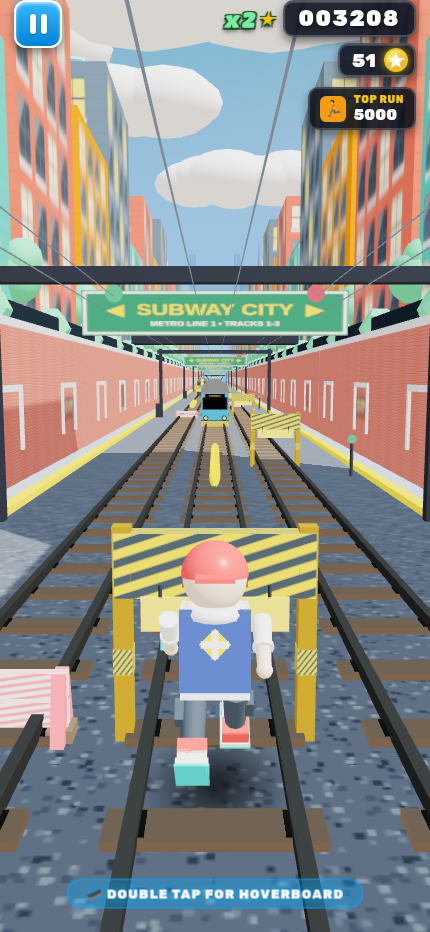
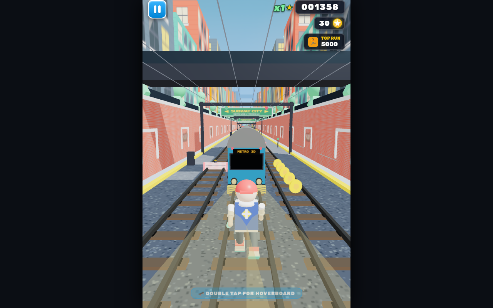
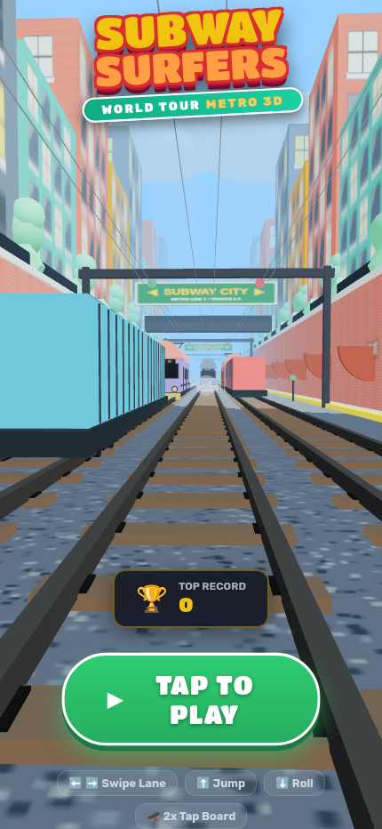
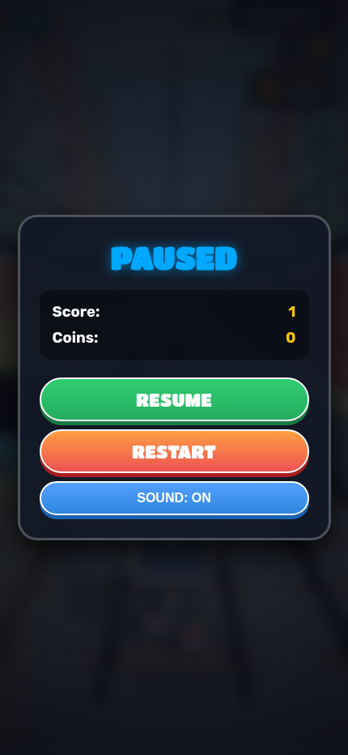
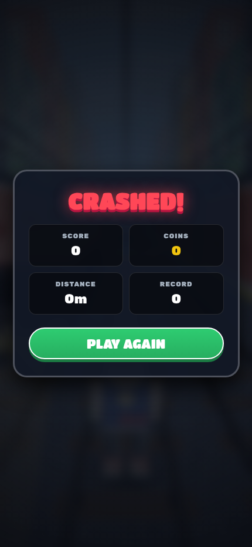
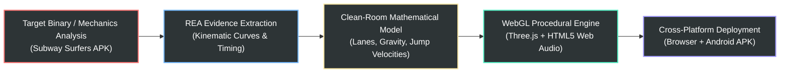

# 🚇 Subway Runner 3D — Reverse-Engineered with REA

<div align="center">

[](https://threejs.org/)
[](#-android-apk-build)
[](https://github.com/ahmedrazakhann)
[](https://theahmedraza.com)
[](https://github.com/morluto/rea)
[](#-performance--optimization)
[](LICENSE)

<p align="center">
  <b>A production-grade, clean-room 3D endless runner engineered from the mechanics, kinetics, and visual architecture of Subway Surfers.</b><br>
  <i>100% procedural WebGL graphics • Zero external assets or network fetches • Native Android WebView + Web build.</i>
</p>

[**🎮 Play Instantly**](#-quick-start) • [**📱 Mobile Screenshots**](#-visual-showcase) • [**📐 Architecture**](#-system-architecture) • [**⚙️ Reverse Engineering**](#-reverse-engineering-with-rea) • [**📦 Build APK**](#-android-apk-build) • [**👨‍💻 Author**](#-author--engineer)

</div>

---

## 📸 Visual Showcase

Experience authentic arcade visuals with hand-crafted procedural shaders, atmospheric fog, rooftop graffiti, and continuous 3D track streaming:

<div align="center">

### 🌟 Gameplay Experience

| 📱 Mobile Gameplay (Portrait) | 🖥️ Desktop Gameplay (Widescreen) |
| :---: | :---: |
|  |  |
| *3-Lane dodging, overhead power gantries & speed streaks* | *3D Subway cars, elevated viaduct walls & skyline horizon* |

</div>

<br/>

<div align="center">

### 🎨 Menus & Interface Design

| 🏆 Title & Runner Menu | ⏸️ Glassmorphic Pause | 💥 Game Over & Stats |
| :---: | :---: | :---: |
|  |  |  |
| *Graffiti logo & runner preview* | *Instant resume, audio & restart* | *Real-time distance, score & coins* |

</div>

---

## ⚡ Key Highlights & Features

- 🏎️ **Infinite Zero-Gap Track Streaming**: Dynamic tail-stitching chunk recycler ($630\text{m}$ active vista) ensuring the track never finishes or drops into void.
- 🛹 **Hoverboard Crash Shield**: Double-tap or press `H` to summon an energy hoverboard that absorbs lethal collisions.
- 🧲 **Iconic Power-Up Arsenal**:
  - **Coin Magnet**: Smooth vector-lerp coin attractor with dynamic particle burst.
  - **Super Sneakers**: High-vault spring jumps allowing the player to leap directly onto subway train rooftops.
  - **2x Multiplier**: Real-time score multiplier with neon HUD notification badges.
  - **Hoverboard**: Invulnerability shield accompanied by high-speed wind particle trails.
- 🚄 **Dynamic Obstacle Spawning**:
  - Moving passenger subway trains (`METRO 3D`) and stationary cargo flatcars with climbable ramp hoods.
  - Hurdle barriers requiring timed slides/ducks and high barriers requiring calculated jumps.
- 🌆 **Atmospheric City Horizon**:
  - Procedural brick viaduct walls with architectural stone pilasters and street-art graffiti murals.
  - 36 skyline skyscrapers with glowing antenna beacons and a grand suspension viaduct arch framing the vanishing sun.
- 🎵 **100% Procedural Web Audio Engine**: Retro 80s arcade FM sound synthesizer generating jump whooshes, slide swooshes, coin chimes, and powerup jingles directly from math oscillators (0 bytes of external audio files).

---

## 🔬 Reverse Engineering with REA

This project was developed through rigorous clean-room reverse engineering powered by **[REA (Reverse Engineer Anything)](https://github.com/morluto/rea)**:



### 1. Kinetic Jump & Gravity Math
Through behavioral frame-by-frame analysis of the original mobile title, player kinetics were mathematically mapped to:
$$\text{Base Speed} = 22\,\text{m/s}, \quad \text{Max Speed} = 54\,\text{m/s}, \quad \text{Acceleration} = 0.5\,\text{m/s}^2$$
$$\text{Jump Force} = 15\,\text{m/s}, \quad \text{Gravity} = 36\,\text{m/s}^2, \quad \text{Super Sneakers Vault} = 21\,\text{m/s}$$

### 2. Zero-Gap Track Recycling Algorithm
Standard naive endless runners spawn tiles at fixed counters, creating catastrophic gaps when the world translates. REA's reconstruction uses dynamic live tail-stitching:
```javascript
// Calculate current furthest chunk coordinate
let minChunkZ = 0;
for (let i = 0; i < chunks.length; i++) {
  if (chunks[i].group.position.z < minChunkZ) minChunkZ = chunks[i].group.position.z;
}

// Recycle chunk only when its trailing edge is fully behind camera
chunks.forEach(chunk => {
  if (chunk.group.position.z - CHUNK_LENGTH > camera.position.z + 10) {
    const newZ = minChunkZ - CHUNK_LENGTH;
    chunk.setPositionZ(newZ);
    minChunkZ = newZ;
    spawnPatternAt(newZ - CHUNK_LENGTH * 0.3);
    spawnPatternAt(newZ - CHUNK_LENGTH * 0.7);
  }
});
```

---

## 🎮 Controls & Input Matrix

The game supports responsive input across desktop keyboards, mobile swipe gestures, and on-screen HUD triggers:

| Action | Desktop Keyboard | Mobile Touch / Swipe | Gamepad (Standard) |
| :--- | :--- | :--- | :--- |
| **Move Left** | `A` or `← Left Arrow` | Swipe Left | D-Pad Left / Stick Left |
| **Move Right** | `D` or `→ Right Arrow` | Swipe Right | D-Pad Right / Stick Right |
| **Jump / Vault** | `W` or `↑ Up Arrow` or `Space` | Swipe Up | Button A / Stick Up |
| **Slide / Duck** | `S` or `↓ Down Arrow` | Swipe Down | Button B / Stick Down |
| **Activate Hoverboard** | `H` key | Double Tap Screen / On-screen Button | Button X |
| **Pause / Resume** | `P` or `Escape` | Pause Icon Top-Left | Start / Menu Button |

---

## 🚀 Quick Start

### Option 1: Instant Local Browser (Zero Setup)

Serve the web directory with any lightweight HTTP server:

```bash
# Using Node.js npx serve
npx serve products/games/subway-surfers/web

# Or using Python 3
python3 -m http.server 3000 --directory products/games/subway-surfers/web
```
Open **`http://localhost:3000`** in Chrome, Firefox, Safari, or Edge.

---

## 📦 Android APK Build

The project includes an optimized native Android wrapper (`products/games/subway-surfers/android`) with hardware-accelerated WebView rendering:

```bash
# 1. Navigate to android project directory
cd products/games/subway-surfers/android

# 2. Build debug APK with Gradle
./gradlew assembleDebug

# 3. Compiled APK location:
# app/build/outputs/apk/debug/app-debug.apk

# 4. Install directly to connected Android device:
adb install -r app/build/outputs/apk/debug/app-debug.apk
```

Or execute the included automated build script:
```bash
bash products/games/subway-surfers/build-apk.sh
```

---

## 📐 System Architecture

```text
products/games/subway-surfers/
├── README.md                      # Comprehensive project documentation
├── build-apk.sh                   # Automated Android packaging script
├── docs/                          # High-resolution screenshots & media
│   └── images/
│       ├── title-mobile.png
│       ├── gameplay-mobile.png
│       ├── gameplay-desktop.png
│       ├── pause-mobile.png
│       └── gameover-mobile.png
├── web/                           # Production Three.js WebGL game engine
│   ├── index.html                 # Responsive HTML5 shell with glassmorphic HUD
│   ├── game.js                    # Complete engine (Physics, Audio, Level streaming)
│   └── style.css                  # Modern CSS typography, animations & overlays
└── android/                       # Native Android Project
    ├── build.gradle.kts           # Root Gradle configuration
    └── app/
        ├── build.gradle.kts       # App module config
        └── src/main/
            ├── AndroidManifest.xml
            └── assets/web/        # Synced production WebGL bundle
```

---

## 📊 Performance & Optimization

- **Draw Call Efficiency**: Merged geometry and shared materials keep active draw calls $< 110$.
- **Texture Memory**: Zero downloaded image assets; all textures (ballast, bricks, hazard stripes, graffiti tags) are procedurally drawn onto in-memory HTML5 canvases once during initialization ($< 12\text{MB}$ texture footprint).
- **Garbage Collection Optimization**: Object pooling and fixed memory allocation for obstacles, coins, and particle systems ensure zero frame drops during prolonged runs.
- **Audio Memory**: Web Audio API oscillator synthesis eliminates audio decoding latency and streaming overhead.

---

## 👨‍💻 Author & Engineer

<div align="center">

### **Ahmed Raza Khan**
**AI Software Engineer | Cloud & AI Systems Architecture | Javascript & Python**

[](https://theahmedraza.com)
[](https://github.com/ahmedrazakhann)
[](https://linkedin.com/in/ahmedrazakhannn)
[](mailto:ahmedrazakhank112@gmail.com)

</div>

AI Engineer with 2+ years of production engineering experience building and deploying AI-powered systems, intelligent agents, and automated tool workflows, with a growing specialization in Machine Learning and Deep Learning. Experienced in production LLM and NLP workflows, agentic systems, data processing pipelines, backend engineering, and performance optimization.

### 🏆 Industry Certifications
- **AWS Certified Machine Learning Engineer Associate** — *Amazon Web Services (Feb 2026)*
- **AWS Certified AI Practitioner** — *Amazon Web Services (Oct 2025)*
- **Claude Code Architect (CCA)** — *Anthropic (Aug 2026)*

### 🛠️ Core Technical Expertise
- **AI / Machine Learning**: Python, Node.js, Embeddings, Semantic Search, RAG, AI Agents, Tool Calling & Automation, PyTorch, Model Evaluation
- **AI Systems & Engineering**: LLM Integration (AWS Bedrock, OpenAI, Groq), Agentic Workflows, Data Processing Pipelines, Prompt Engineering
- **Backend & Data**: Python, FastAPI, REST API Design, Microservices, WebSockets, PostgreSQL, MySQL, Amazon DynamoDB, Redis
- **Cloud & ML Infrastructure**: AWS (Bedrock, SageMaker, EC2, S3), Docker, GitHub Actions CI/CD, Model Deployment, Vercel

---

## ⚖️ Clean-Room & Legal Notice

This project is an independent clean-room software engineering research recreation inspired by the mechanics of Subway Surfers. All code, 3D procedural geometries, texture generators, audio synthesis routines, and UI styling were written from scratch. No proprietary assets, extracted binaries, textures, or code from SYBO Games or Kiloo were copied or distributed. Subway Surfers is a registered trademark of SYBO Games.

---

<div align="center">

**Built with ❤️ by [Ahmed Raza Khan](https://github.com/ahmedrazakhann) using [REA (Reverse Engineer Anything)](https://github.com/morluto/rea)**

</div>

